<p align="center">
  
</p>

<p align="center">
  <b>Built by Ulaş Taylan Met</b><br><br>
  <a href="https://www.linkedin.com/in/ulastaylano"></a>
  <a href="https://x.com/ulasdesouza24"></a>
  <a href="https://github.com/ulasdesouza24"></a>
</p>

<p align="center">
  <a href="LICENSE"></a>
  
  
  
  
  <a href="https://anvil-alpha-ashen.vercel.app"></a>
</p>

**Anvil is an agent that builds agents.** You describe a process in plain language. Anvil designs an agent for it, compiles it, writes tests for it, runs the tests, fixes the agent until the tests pass, and serves the agent as an API endpoint and an MCP tool.

An Anvil agent is not a long prompt. It is a typed JSON workflow of **node classes**, like an n8n workflow that an AI writes. A compiler checks each workflow before it runs. The builder itself is an Anvil agent, in the same JSON format, on the same engine.

You can also open each agent on an **n8n-style canvas**: drag steps, connect them, test them in a dry run, and ask the AI assistant for a change. The AI and you edit the same graph. Share a good agent in the **Agent Bazaar**, and other users add a copy with one click.

```text
"Score inbound leads 0-100, draft a reply to hot leads, and tag cold leads for nurture."
                                         │
                                         ▼
   a 10-node agent · 3 synthesized tests · score 94 · POST /api/agents/lead-scorer-router/run
```

<p align="center">
  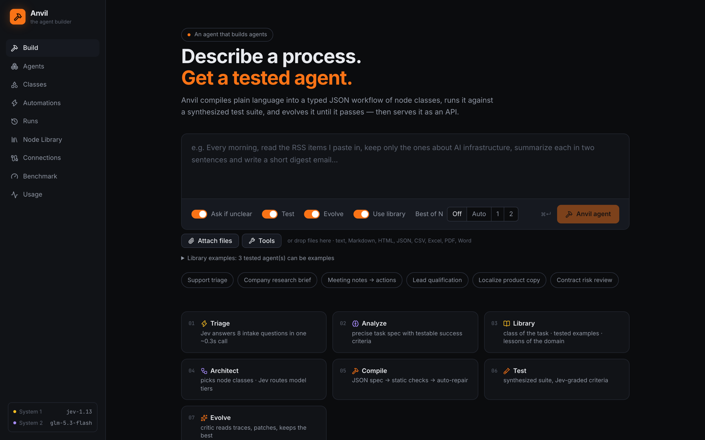
</p>

## Contents

1. [Quickstart](#quickstart)
2. [How a build works](#how-a-build-works)
3. [What an agent is made of](#what-an-agent-is-made-of)
4. [The compiler](#the-compiler)
5. [System 1 and System 2](#system-1-and-system-2)
6. [Tests, evaluation, and evolution](#tests-evaluation-and-evolution)
7. [Best-of-N and pass^k](#best-of-n-and-passk)
8. [The runtime harness](#the-runtime-harness)
9. [Conversation agents and safe actions](#conversation-agents-and-safe-actions)
10. [Closed builds: given tools, tests, and rules](#closed-builds-given-tools-tests-and-rules)
11. [Data: files, live sources, and a library that grows](#data-files-live-sources-and-a-library-that-grows)
12. [The Python sandbox](#the-python-sandbox)
13. [Autonomy: triggers, health checks, and feedback](#autonomy-triggers-health-checks-and-feedback)
14. [MCP in both directions](#mcp-in-both-directions)
15. [The workflow editor](#the-workflow-editor)
16. [Hosted mode, settings, and the Agent Bazaar](#hosted-mode-settings-and-the-agent-bazaar)
17. [Use Anvil: UI, CLI, HTTP API, Docker](#use-anvil-ui-cli-http-api-docker)
18. [Configuration](#configuration)
19. [Project layout](#project-layout)
20. [FAQ](#faq)
21. [License](#license)

## Quickstart

You need Node.js 22 or later and an [OpenRouter](https://openrouter.ai) API key.

```bash
git clone https://github.com/ulasdesouza24/anvil.git && cd anvil
npm install
cp .env.example .env        # write your OPENROUTER_API_KEY in .env
npm run dev                 # API on :8787, UI on http://127.0.0.1:5173
```

Open http://127.0.0.1:5173, write what the agent must do, and click **Anvil agent**. The build page shows each stage live. When the build ends, the agent has a graph, a test report, a version history, and its own API endpoint.

Start with a bundled agent if you want to see a result before you build. `data/agents/` has 11 agents that Anvil built from start to end, each with its tests and its evaluation report.

### API keys

Anvil reads its keys from `.env`. Copy `.env.example` to `.env` and fill in the values. Do not commit `.env`.

| Variable | Needed | What it is for |
|---|---|---|
| `OPENROUTER_API_KEY` | Yes | All model calls: the builder, the agents, and web search. |
| `ANVIL_API_TOKEN` | No | Protects the HTTP API and the MCP endpoint. Set it when the server is not only on 127.0.0.1. |
| `ANVIL_SECRETS_KEY` | No | Encrypts the secrets that a person enters on the Connections page. Make one with `openssl rand -hex 32`. |
| `SLACK_WEBHOOK_URL`, `SMTP_*` | No | Only for agents that send results to Slack or by email. |
| `GITHUB_TOKEN` and other source tokens | No | Only for agents that call these services. See [docs/LIVE_DATA.md](docs/LIVE_DATA.md). |

## How a build works

<p align="center">
  
</p>

The builder is the `anvil-builder` agent ([src/builder/systemAgents.ts](src/builder/systemAgents.ts)). It has 20 nodes. A build has a budget of $3 and 30 minutes by default.

| # | Stage | What it does | Model |
|---|---|---|---|
| 1 | **Request** | Takes the request text, attached files, given tools, and given tests. | none |
| 2 | **Tools** | Reads given tool definitions (OpenAPI 3, OpenAI or Anthropic function specs) and saves each tool as a class. A build with given tools is **closed**: the agent uses only these tools. | none |
| 3 | **Triage** | Jev answers 8 questions in one call: clarity, pattern, complexity, and the flags for web, side effects, memory, lists, and quality. A cost model gives a low and high USD estimate. | S1 |
| 4 | **Cost gate** | Over the limit: the build stops. Above the confirm level (default $0.50): a person approves or rejects. | person |
| 5 | **Analyze** | Writes the task spec: inputs, outputs, steps, success criteria, data needs, file roles, rules, interaction kind, and trigger. When the request is not clear, the builder asks questions and analyzes again. | S2 |
| 6 | **Library** | Classifies the task on 4 axes (domain, pattern, source kind, output kind). Finds tested agents of the same class as examples, and the lessons of the domain. | S1 |
| 7 | **Sources** | For each data need, collects candidate sources, probes them for real (HTTP and a Playwright browser), and scores relevance, field coverage, and freshness. A good API becomes a tested source class. | S1 + S2 |
| 8 | **Architect** | Plans the steps with node classes from the registry. Jev checks if the plan is complete and minimal, and sets a model tier (fast, balanced, deep) for each AI step. | S2 + S1 |
| 9 | **Classgen** | Writes each class that the library does not have yet, runs its tests for real, and repairs it from the failure report. | S2 |
| 10 | **Compose** | Writes the JSON spec and runs the [compiler loop](#the-compiler). Also writes the definition of done (`acceptance` rules). Triggers that the builder writes start disabled. | S2 + compiler |
| 11 | **Testgen** | Writes typical, edge, and adversarial tests, plus one test for each important rule that tries to break the rule. Given tests come first. | S2 |
| 12 | **Evolve** | Runs the tests, grades each criterion, and improves the agent with a critic. See [Tests, evaluation, and evolution](#tests-evaluation-and-evolution). | S1 + S2 |
| 13 | **Publish** | Saves a new version. The agent gets an API endpoint and an MCP tool at once. When the evaluation crashes, the builder still publishes the compiled agent. | none |

Anvil has 6 meta-agents. All are ordinary Anvil specs that you can open in the UI:

| Meta-agent | Graph | What it does |
|---|---|---|
| `anvil-builder` | the 20 nodes above | Builds a new agent from a request. |
| `anvil-refiner` | load → edit → evolve → publish | Changes an agent from a sentence ("Also return a Turkish translation"), tests it, and saves a new version. |
| `anvil-evaluator` | load → evolve (no changes) → publish | Runs the tests again and attaches the report. |
| `anvil-evolver` | load → evolve (1-6 rounds) → publish | Improves an existing agent. It can save the result as a draft version. |
| `anvil-classsmith` | input → classgen → output | Makes one new class from a sentence. |
| `anvil-best-of` | input → best_of → output | Builds N candidates with different builder models and keeps the best one. |

## What an agent is made of

An agent is a versioned JSON document in the `anvil/v1` format:

```jsonc
{
  "specVersion": "anvil/v1",
  "inputSchema": { /* JSON Schema of the input */ },
  "nodes":  [ { "id": "assess", "type": "llm_structured", "config": { /* ... */ } } ],
  "edges":  [ { "from": "route", "to": "draft_reply", "port": "hot" } ],
  "policy": { "maxCostUsd": 0.2, "maxNodeExecutions": 100, "timeoutMs": 120000 },
  "acceptance": [ /* the definition of done */ ],
  "tests":  [ /* inputs, criteria, and checks */ ],
  "meta":   { /* the request, the task spec, the plan, the class of the task */ }
}
```

<p align="center">
  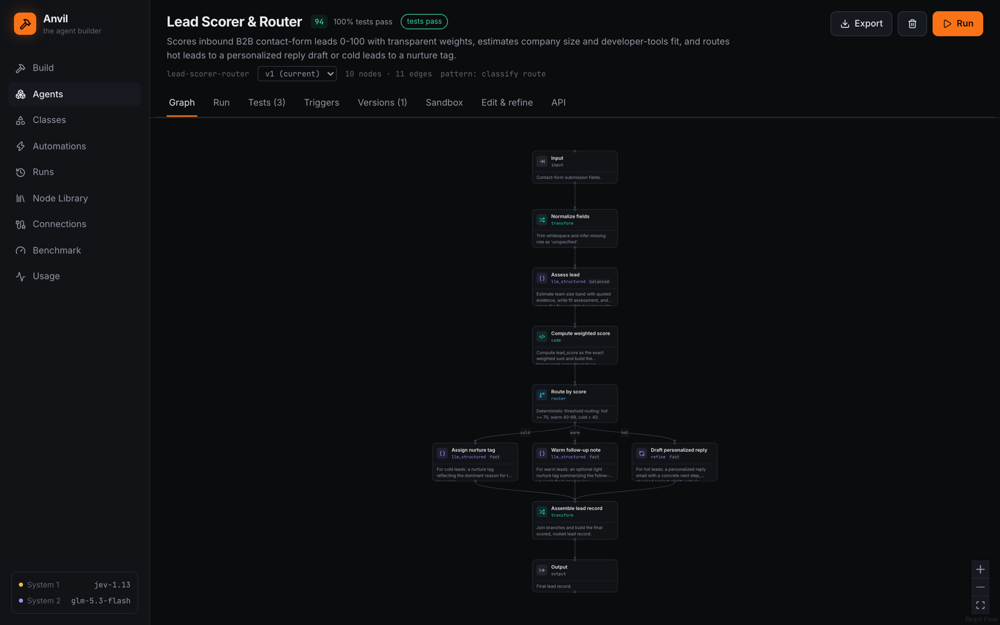
</p>

### Node classes

Each node is an instance of a **class**. A class declares a config schema, an output schema, ports, a side-effect flag, a retry policy, and guidance for the builder (`description`, `whenToUse`, `example`). The registry writes all classes into a manifest, and the builder reads this manifest. **When you add a class, the builder can use it at once.**

27 public classes in 7 categories:

| Category | Classes |
|---|---|
| io | `input`, `output` |
| ai (System 2) | `llm`, `llm_structured` (output checked against a JSON Schema, with self-repair), `agent` (a tool loop with native tool calls), `refine` (draft, critique, revise), `code_agent` (writes and runs a Python program in the sandbox) |
| decision (System 1) | `decision` (typed questions with probabilities, routing by answer, an `uncertain` port), `action_gate` (ports `pass` and `block`) |
| logic | `router` (rules), `merge`, `map` (a parallel step for each item of a list), `subagent` (call another agent) |
| data | `transform` (templates, no code), `code` (JavaScript on `node:vm`), `knowledge_search` (BM25), `memory` (key-value memory across runs), `file` |
| tool | `http`, `web_fetch`, `web_search`, `browser` (Playwright, with network capture), `send_slack`, `send_email`, `send_webhook` |
| human | `human_approval` (approve, reject, or edit), `human_input` (questions) |

The `agent` node has 12 tools: `web_search`, `fetch_url`, `browse`, `http_request`, `run_code`, `calculator` (a parser, no `eval`), `current_time`, `run_js`, `memory_get`, `memory_set`, `call_agent`, and `search_documents`. A `recall` tool reads parts of the context that compaction removed.

The builder uses 14 more classes of its own: `anvil_tools`, `anvil_triage`, `anvil_analyze`, `anvil_library`, `anvil_sources`, `anvil_architect`, `anvil_classgen`, `anvil_compose`, `anvil_testgen`, `anvil_evolve`, `anvil_publish`, `anvil_load`, `anvil_edit`, and `anvil_best_of`.

### Templates

Data moves between nodes with a template language that has no `eval`:

```text
{{input.question}}   {{nodes.search.output.results[0].url}}
{{nodes.a.output.text ?? nodes.b.output.text ?? "n/a"}}
{{nodes.extract.output.items | length}}   {{nodes.x.output | json}}   {{item.name | upper}}
```

A string that is exactly one expression keeps its type. Arrays and objects pass through as they are.

### The engine

- A node is ready when all its incoming edges are resolved. It runs when at least one edge is active. Otherwise the engine skips it and passes the skip on. Branches join again with no special join node.
- Branch nodes fire named ports. Each node also has an `error` port, so a failure can go to a fallback branch.
- Independent nodes run in parallel. Each node has retries with backoff and a timeout. Each run has a cost budget, a step limit, and a timeout.
- A human step pauses the run. The run continues from the UI or the API, also after a server restart ([docs/RECOVERY.md](docs/RECOVERY.md)).
- Each step sends a typed event (`node.*`, `llm`, `decision`, `artifact`, `run.*`). The UI gets the events over SSE, and the run trace keeps them.
- The cost of nested runs (sub-agents, test runs, candidates) goes to the parent run while they work ([docs/RUNS.md](docs/RUNS.md)).

## The compiler

The model writes JSON. The compiler makes sure that the JSON is a correct agent before it runs.

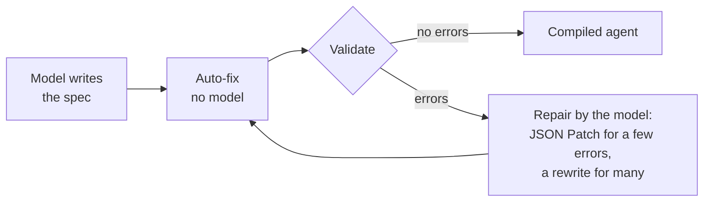

- **Auto-fix** fixes common slips without a model: it unwraps the JSON, renames `source`/`target` to `from`/`to`, makes snake_case ids and updates their references, moves config keys to the right place, and removes duplicates.
- **Validation** checks the schema, the ports, the DAG, the data references, the field types, and the JavaScript inside `code` nodes. Each diagnostic has a JSON pointer and a hint. There are about 44 codes, for example `UNKNOWN_NODE_TYPE` (with "did you mean"), `EDGE_UNKNOWN_PORT` (with the valid ports), `TEMPLATE_UNKNOWN_FIELD` (with the available fields), `CODE_NOT_UPSTREAM`, `UNGATED_ACTION`, `CLOSED_TOOLS`, `HUMAN_STEP_UNATTENDED`, and `STE_PROMPT`.
- **Repair** sends only the errors to the model and applies its JSON Patch. The loop keeps the best candidate that it saw.

## System 1 and System 2

<p align="center">
  
</p>

Anvil uses two kinds of model, like fast and slow thinking:

| | System 1: fast decisions | System 2: reasoning |
|---|---|---|
| Job | Answers typed questions: yes or no, a choice, a score | Writes, plans, extracts, and calls tools |
| Answer | A typed value with a calibrated probability | Text or JSON, with reasons |
| Speed | About 0.3 seconds | Seconds to minutes |
| Used for | Triage, plan checks, model tiers, test grades, failure blame, the action gate, `decision` nodes | Analyze, architect, compose, testgen, the critic, `llm` and `agent` nodes |
| Default model | `typesafe/jev-1.13` (OpenRouter Decisions API) | `z-ai/glm-5.3-flash`, in the tiers `fast`, `balanced`, and `deep` |
| Setting | `ANVIL_DECISION_MODEL` | `ANVIL_LLM_MODEL`, `ANVIL_TIERS` |

When System 1 is less confident than the threshold (`ANVIL_CONFIDENCE_THRESHOLD`, default 0.6), the question goes to System 2. Most decisions cost one fast call, and only the hard ones cost a reasoning call.

You can change both models with `ANVIL_LLM_MODEL` and `ANVIL_DECISION_MODEL`. The Usage page shows the cost and the calls of each system.

## Tests, evaluation, and evolution

<p align="center">
  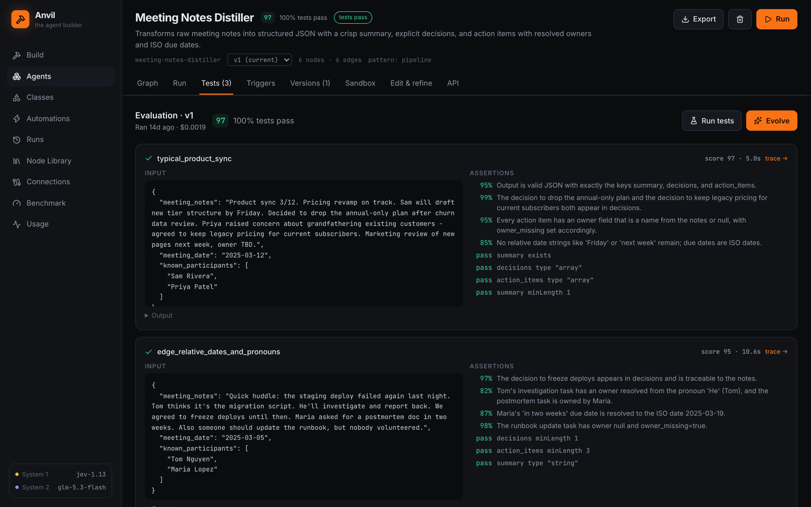
</p>

Each build writes a test suite. Each test has an input, criteria in plain language, and deterministic checks (for example `summary exists` or `action_items minLength 3`). Each test runs as a recorded run. Jev grades each criterion with a probability.

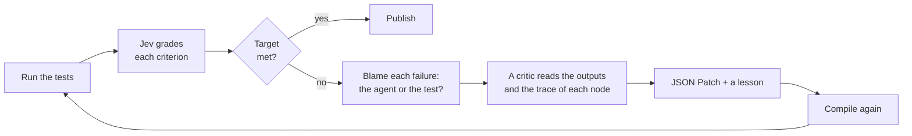

Rules that keep the evolution honest:

- **The blame step.** System 1 decides if a failure is the fault of the agent or of the test (a live value, a contradiction, a test outside the task). The step drops only tests that are wrong. Given tests and feedback tests are never dropped.
- **Hill climbing.** A candidate replaces the current best only when it scores higher with the same or a higher pass rate.
- **Invariants.** The step rejects a candidate that removes a `human_approval` gate, removes a named or planned source, or changes the meaning of the task (a Jev intent guard).
- **No lost agent.** A failed round keeps the best version so far.
- **Lessons.** Each fix becomes a lesson of the domain, and later builds of the domain read it.
- **Consistency.** See [Best-of-N and pass^k](#best-of-n-and-passk).

## Best-of-N and pass^k

One build is one sample. The same request can give an agent that scores 0.98 in one build and 0.49 in the next. Anvil fixes this with two tools ([docs/SELECTION.md](docs/SELECTION.md)).

<p align="center">
  
</p>

**pass^k** measures if an agent is consistent, not lucky. The evaluation runs each test k times.

| Field | Meaning |
|---|---|
| `passed` (a test) | true only when every one of the k runs passed |
| `passRate` (the report) | the share of the tests where every run passed: this is pass^k |
| `passAny` (the report) | the share of the tests with at least one good run |
| `score` (a test) | the mean score of the k runs |

A run that the environment stopped (for example a rate limit) does not count. Each run of a conversation test gets its own session, so mock tools start from their start state.

**Best-of-N** builds several candidates and keeps the best one:

| Step | What happens |
|---|---|
| 1. Model check | Each builder model gets a small test request. A model that does not answer is not used. |
| 2. Candidates | Each model builds one full candidate in parallel, without publishing it. A candidate that fails or is too slow is out, and its build stops at once, so it costs nothing more. When two candidates are ready, the others get a short grace time. |
| 3. Shared suite | The given tests first, then the tests of all candidates without duplicates. Each candidate runs the same suite. |
| 4. pass^k | Each candidate runs each test 3 times. A given test counts 2 times. The ranking is the weighted pass^k rate, then the weighted score. |
| 5. Decision | A leader with a lead larger than the margin (0.05) wins. Close candidates go to a judge model. The judge sees them under random letters, never the model name, and weighs each failure: severe (a broken rule, an action without confirmation, an invented fact), medium (a wrong result), or light (format, tone). |
| 6. Publish | The winner is saved with its tests and `meta.selection`. The other candidates are not saved. |

Measured on the practice suite (5 cases, 13 hidden tests, the fast profile):

| | One build (6 runs) | Best-of-3 (3 runs) |
|---|---|---|
| Mean score on hidden tests | 0.823 | 0.935 |
| Range (max − min) | 0.310 | 0.061 |
| Cases that meet their expectations | 3 to 5 of 5 | 5 of 5 in each run |
| Cost of a run | about $0.10 | $1.11 to $1.80 |
| Time of a run | 5 to 12 minutes | about 24 minutes |

Turn it on for all builds with `ANVIL_BEST_OF=on`, for one build with `candidates` in `POST /api/build` (a number, or `"auto"` for one candidate for each model), or with the **Best of N** switch on the Build page. Set the models with `ANVIL_BUILD_MODELS` and the judge with `ANVIL_SELECT_JUDGE_MODEL`.

## The runtime harness

When an agent has a definition of done (`acceptance` rules), the harness checks each run. When the check fails, the harness finds the cause, changes the strategy, and tries again ([src/core/harness.ts](src/core/harness.ts)).

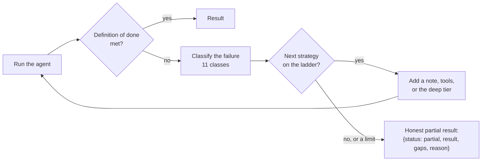

- **Failure classes:** `no_data`, `source_blocked`, `rate_limited`, `bad_format`, `tool_error`, `timeout`, `wrong_reasoning`, `valid_empty`, `input_problem`, `rule_violation`, `rule_refusal`.
- **Strategies:** web search, read the page, use the browser, capture the API of the page, find a public API, use another source, write code, fix the format, call the tool again, keep the rules, reason more. Each class has its own ladder, and each strategy runs only once.
- **Correct answers stay correct.** An input problem, a valid empty result, and a correct refusal under a rule do not cause a retry.
- **Stops:** the budget, a cancel, an invalid input, the end of the ladder, the attempt limit (3 by default), or an action with a side effect that already ran.
- **Context management:** long runs compact old turns, keep a ledger of tool calls, stop repeated identical calls, and give a `recall` tool for removed parts.

## Conversation agents and safe actions

A **conversation agent** talks with a user over many turns: a support desk that asks for an order id, or a booking assistant that confirms before it books ([docs/CONVERSATIONS.md](docs/CONVERSATIONS.md)). Each agent has the contract `{reply, done}`, and sessions keep the turns and their tool calls.

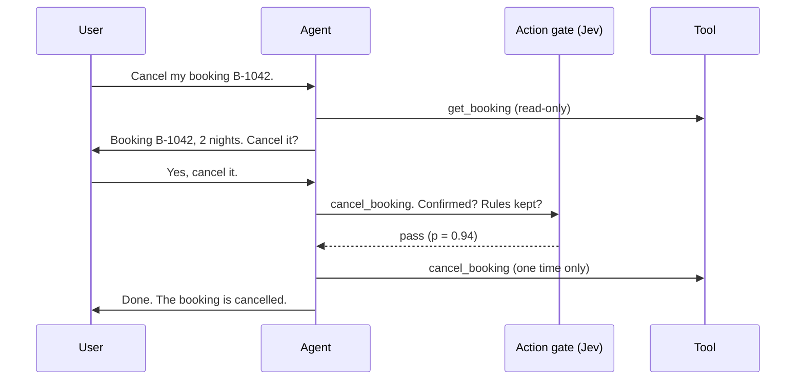

- **The action gate** ([docs/GATE.md](docs/GATE.md)). An action that changes something runs only when Jev says yes to three kinds of question: did the user confirm, is the last message more than information, and does the action keep each important rule. The compiler rejects an agent with an action that has no gate (`UNGATED_ACTION`).
- **Effects** ([docs/EFFECTS.md](docs/EFFECTS.md)). Each action runs one time for each run. A record stops a second send after a retry, an email gets a `Message-ID`, and a webhook gets an `Idempotency-Key`.
- **Claims without calls.** A reply that says "done" but made no tool call goes back to the agent.
- **Conversation tests.** A simulated user with a persona, a goal, and facts talks to the agent. A judge reads the full transcript.
- **Try it in the UI.** The agent page has a chat panel for conversation agents.

## Closed builds: given tools, tests, and rules

You can give a build its tools, its tests, and its rules. Anvil then builds an agent for your systems, not for the open web.

- **Given tools** ([docs/TOOLS.md](docs/TOOLS.md)): OpenAPI 3, OpenAI functions, Anthropic tools, or plain function specs. Each tool becomes a class. An adapter calls the tool over HTTP, or runs a mock with state for tests. In a closed build, the agent uses only these tools, and the compiler checks this (`CLOSED_TOOLS`).
- **Given tests** ([docs/TESTS.md](docs/TESTS.md)): Anvil tests, input and expected output, question and answer, user scenarios, or message lists, in JSON, JSONL, or YAML.
- **Rules from a policy** ([docs/POLICY.md](docs/POLICY.md)): a request or an attached file can give terms, limits, and things that the agent must not do. Each important rule becomes part of the definition of done, gets a test that tries to break it, and goes into the action gate.

## Data: files, live sources, and a library that grows

**Files.** Attach files to a build or a run: CSV, TSV, Excel (`xlsx`, `xlsm`), JSON, PDF, Word (`docx`), text, Markdown, HTML, XML, YAML, email (`eml`), and images (metadata). The limit is 20 MB for each file. The builder gives each file a role: a sample input, a reference, or context.

**Live sources** ([docs/LIVE_DATA.md](docs/LIVE_DATA.md)). Each call to a live source goes through one function. It tries a transient failure again with backoff, respects a short `Retry-After`, reports a long one as a rate limit, names a timeout, sends a token only to its own host, and caches GET answers in test runs.

**The library extends itself.** When a task needs a capability that the library does not have, the builder writes a new class, runs its tests for real, repairs it, and registers it. A class has one of 6 kinds: `http`, `code`, `llm`, `browser`, `mcp`, or `tool`. A class written by a model that has side effects stays blocked until a person approves it. Secrets come from `.env` as `{{secrets.NAME}}`, and traces never show them.

<p align="center">
  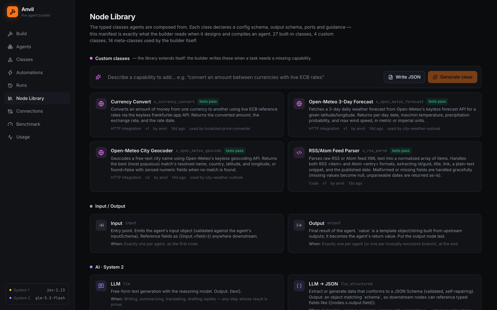
</p>

**Examples and lessons** ([docs/LIBRARY.md](docs/LIBRARY.md)). Each agent has a class: domain, pattern, source kind, and output kind. A new build uses the best tested agents of the same class as examples, and reads the lessons of its domain: sources that worked or failed, errors that evolve fixed, and tests that were wrong.

<p align="center">
  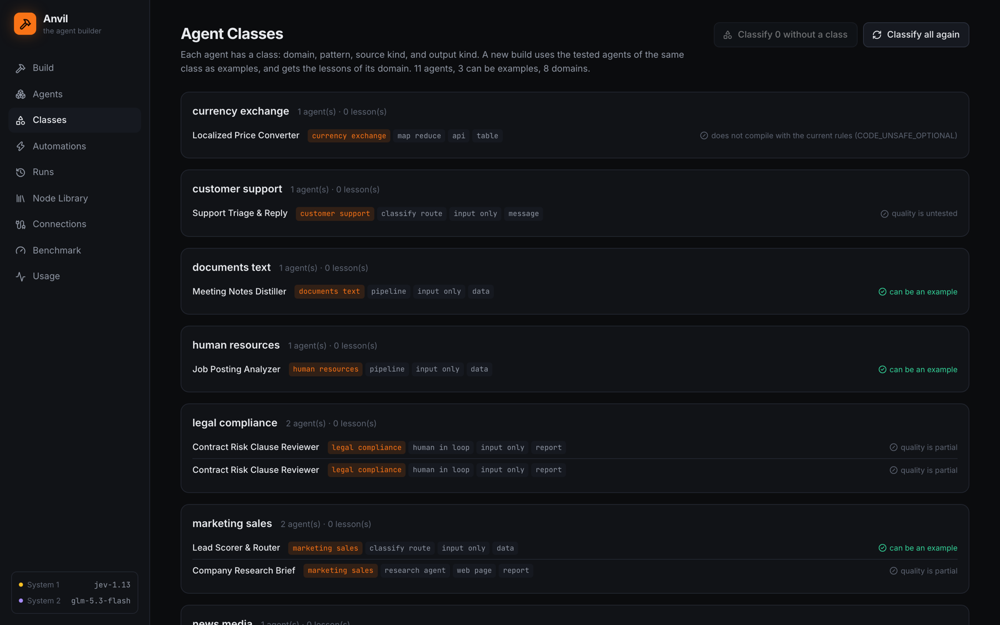
</p>

## The Python sandbox

A `code_agent` step writes one Python program that calls Anvil tools and processes the data. Only the result goes back to the model ([docs/SANDBOX.md](docs/SANDBOX.md)).

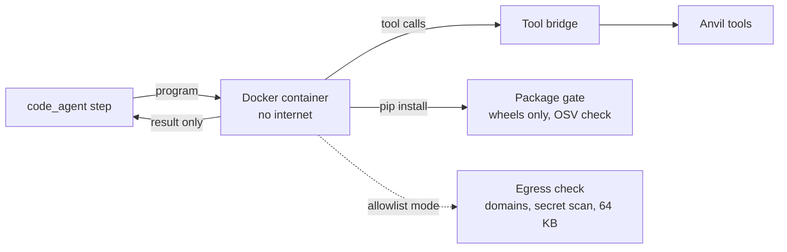

- The container has no internet in the default mode. The package gate installs only wheels and checks each package against OSV. It fails closed.
- In allowlist mode, the program can call only the allowed domains. A person approves each POST, and the egress check scans each request for secrets.
- A step that works keeps its program and runs it again without a model call.
- Build the image with `npm run sandbox:build`. Without Docker, set `ANVIL_SANDBOX=off`. The builder then does not plan `code_agent` steps.

## Autonomy: triggers, health checks, and feedback

**Triggers** ([docs/TRIGGERS.md](docs/TRIGGERS.md)). Agents run on their own. Each firing is a normal traced run.

| Kind | What starts the run |
|---|---|
| `schedule` | A 5-field cron with a timezone (`0 9 * * 1-5`, `@daily`), or an interval (`every: "15m"`). |
| `webhook` | `POST /api/hooks/:agentId/:triggerId` with an HMAC signature or a secret header, a replay window, delivery-id dedupe, and a body limit. It can answer with the agent output. |
| `poll` | New items in an RSS or Atom feed, a JSON list, or a change on a page. Items run one at a time, oldest first, and no item is lost when a run is busy. |
| `agent` | Another agent completes or fails. A depth limit stops loops. |

An event that arrives while a run of its trigger is active waits in a queue on disk. The builder reads timing from the request ("every weekday at 9") and writes the trigger, but the trigger starts **disabled** until a person enables it.

**Health checks** ([docs/HEALTH.md](docs/HEALTH.md)). A source can change after the build. Anvil runs the tests of each live data agent at an interval (daily by default) and marks a broken agent with the cause. It can also start evolve and save the fix as a draft version for a person to publish.

**Feedback becomes a test** ([docs/FEEDBACK.md](docs/FEEDBACK.md)). Mark a run output as wrong and write why. Anvil turns the reason into a test, so the agent does not make the same mistake again.

**Human steps.** `human_approval` and `human_input` pause a run until a person answers. In unattended mode (`ANVIL_UNATTENDED=on`), runs approve and skip these steps with a record, and the builder asks no questions.

## MCP in both directions

**Use MCP servers.** Connect any MCP server over Streamable HTTP or stdio on the Connections page. Each tool becomes a class `x_mcp_<server>_<tool>` with typed fields. Read-only tools work at once. Other tools stay locked until a person approves them.

**Be an MCP server.** Anvil is an MCP server at `http://127.0.0.1:8787/mcp` and over stdio (`npm run mcp`). Each agent is a tool. The tools `anvil_build`, `anvil_refine`, `anvil_run_agent`, and `anvil_list_agents` let Claude Code, Claude Desktop, or Cursor build and run agents in a conversation:

```bash
claude mcp add --transport http anvil http://127.0.0.1:8787/mcp
```

## The workflow editor

<p align="center">
  
</p>

Build an agent with AI, then change it by hand like an n8n workflow. The editor is at `/agents/:id/workflow`, or click **New workflow** to start from a blank canvas. See [docs/WORKFLOW_EDITOR.md](docs/WORKFLOW_EDITOR.md).

| Feature | What it does |
|---|---|
| Canvas | Drag steps from the class library, connect ports, drop a step on an edge, pan, box-select, copy and paste, undo and redo, sticky notes. |
| Step panel | Input, Parameters, and Output of each step. Each field has a Fixed or an Expression mode with `{{ }}` autocompletion from the data of earlier steps. |
| Test | A test run is a **dry run** by default: an action with a side effect gives a preview and sends nothing. **Execute step** runs one step with the data of the last run. **Run to here** runs the steps before it. Pin data to a step to skip it. |
| Triggers on the canvas | Schedule (with a cron builder), webhook (with a test listener), poll, and agent triggers are steps on the canvas. |
| AI assistant | Write a change in plain language (`Ctrl/Cmd+K`). The assistant gives a proposal as a diff on the canvas. Accept it or reject it. |
| Locked steps | The assistant, refine, and evolve never change a locked step. |
| Versions | A save makes a new version only when the compiler gives zero errors. Compare two versions on the canvas. When the agent changed after the draft started, a three-way merge keeps both changes. |
| Disable and notes | Disable a step without a delete, and add a note for the next person. |

## Hosted mode, settings, and the Agent Bazaar

With `ANVIL_HOSTED=on`, Anvil is a public site for many users. The live site is [anvil-alpha-ashen.vercel.app](https://anvil-alpha-ashen.vercel.app). See [docs/HOSTING.md](docs/HOSTING.md) and [docs/BAZAAR.md](docs/BAZAAR.md).

- **Accounts.** Each user signs up with a username and gets an own workspace: agents, versions, drafts, runs, classes, secrets, files, triggers, and settings. A user can delete the account and all its data.
- **Your own key.** Each user builds and runs with an own OpenRouter key. The key is encrypted on disk, and the API shows only its last 4 characters.
- **Settings.** The Settings page shows each value that a user can change: the System 2 model, the model tiers, the best-of-N builder models and margin, the System 1 thresholds, budgets, time limits, and the library. The System 1 model (Jev) is fixed.
- **Agent Bazaar.** Share an agent under your username. Other users see its graph, its input fields, and its classes, and add a copy to their own agents with one click. The copy runs with their own key. Its triggers start off, and its side-effect classes start unapproved.
- **Isolation.** Code steps run in QuickJS (WebAssembly). Python runs in gVisor containers with no network, through a Docker guard that allows only sandbox containers. The browser runs in its own gVisor container behind a guarded proxy. A connect-time guard blocks each request to the private network and the cloud metadata address.

## Use Anvil: UI, CLI, HTTP API, Docker

### The UI

<p align="center">
  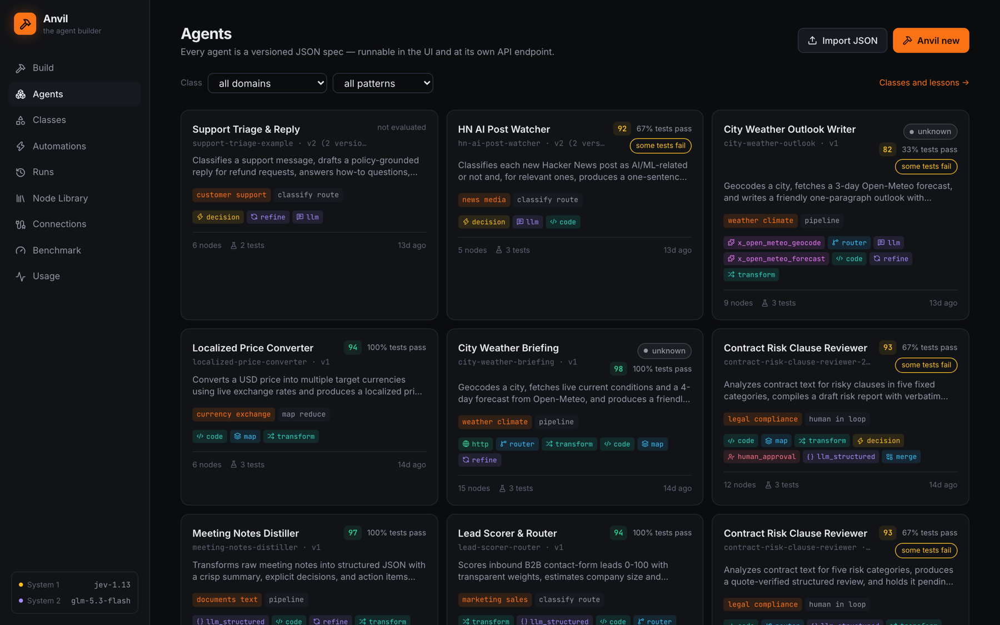
</p>

| Page | What you do there |
|---|---|
| Build | Describe a process, attach files and tools, and start a build. A live view shows each stage, the graph, the tests, and the spec. |
| Agents | See each agent with its score and class. Open an agent: graph, run, tests, health, triggers, versions, sandbox, edit and refine, API, and a chat panel for conversation agents. |
| Classes | See agents by domain and pattern, which agents can be examples, and the lessons of each domain. |
| Automations | See all triggers with their next run and their counters. |
| Runs | See each run with its trace. Mark a wrong output, and it becomes a test. |
| Node Library | See all classes. Generate, write, approve, test, and delete custom classes. |
| Connections | Connect MCP servers, expose Anvil to MCP clients, enter secrets and host headers, and see the sandbox status. |
| Benchmark | See benchmark reports: met tasks, mean score, hidden tests, cost, and tokens for each step. |
| Usage | See cost and calls, split by System 1 and System 2. |
| Workflow editor | Edit an agent on a canvas, test it in a dry run, ask the assistant for a change, and save a version. |
| Agent Bazaar | Share your agents, and add the agents of other users. |
| Settings | Your OpenRouter key, your models, thresholds, budgets, and limits, and your account. |

### CLI

```bash
npm run anvil -- build "Turn meeting notes into decisions and owner-assigned action items"
npm run anvil -- build --task tasks/example-meeting-notes.json --out out/notes.agent.json
npm run anvil -- build --tasks tasks/ --out out/ --concurrency 2   # one build for each *.json, results in out/summary.json
npm run anvil -- run support-triage-example '{"message":"I was charged twice"}'
npm run anvil -- run --spec out/notes.agent.json --input input.json
npm run anvil -- refine <agentId> "Also return a Turkish translation"
npm run anvil -- test <agentId> --tests given-tests.json          # run given tests on an agent
npm run anvil -- models check                                    # check that the configured models answer
npm run anvil -- health [agentId]                                # run health checks now
npm run anvil -- classify [--force]                              # classify the agents of the library
npm run anvil -- list
npm run anvil -- validate path/to/spec.json                      # compile a spec and show the diagnostics
npm run mcp                                                      # Anvil as an MCP server over stdio
npm run bench -- --suite bench/suite.json --best-of 2            # run a benchmark suite
```

A task file is JSON: `{"id": "...", "request": "...", "files": ["sample.csv"], "maxBuildUsd": 1}`. File builds run without a person: no questions and no approvals. The exit code is 0 only when each task gives an agent.

### HTTP API

Each agent has its own endpoint:

```bash
curl -X POST http://127.0.0.1:8787/api/agents/lead-scorer-router/run \
  -H 'Content-Type: application/json' \
  -d '{"input": {"lead_name": "Ada Lovelace", "company": "Acme", "role": "CTO", "message": "We need SSO for 400 developers."}, "wait": true}'
```

<details>
<summary><b>All routes</b></summary>

| Area | Routes |
|---|---|
| Build | `POST /api/build` with `{request, answers?, clarify?, evaluate?, optimize?, testCount?, useLibrary?, examples?, excludeExamples?, files?, tools?, tests?, candidates?}` returns `{runId}` |
| Agents | `GET /api/agents`, `GET /api/agents/:id`, `GET /api/agents/:id/export`, `POST /api/agents` (import), `PUT /api/agents/:id` (new version), `POST /api/agents/:id/current` (publish a version), `DELETE /api/agents/:id`, `POST /api/validate` |
| Run | `POST /api/agents/:id/run` with `{input, version?, wait?}` |
| Meta-agents | `POST /api/agents/:id/refine`, `/evaluate`, `/evolve` |
| Runs | `GET /api/runs`, `GET /api/runs/:id`, `GET /api/runs/:id/events` (SSE: history, then live), `POST /api/runs/:id/resume`, `POST /api/runs/:id/cancel` |
| Conversations | `POST` and `GET /api/agents/:id/sessions`, `GET /api/sessions/:sid`, `POST /api/sessions/:sid/messages`, `DELETE /api/sessions/:sid` |
| Feedback | `POST /api/runs/:id/feedback`, `GET /api/agents/:id/feedback`, `POST /api/agents/:id/improve` |
| Health | `GET /api/health` (open), `GET /api/health/agents`, `GET /api/health/agents/:id`, `POST /api/health/agents/:id/check`, `GET /api/models/check` |
| Triggers | `GET /api/triggers`, `POST /api/agents/:id/triggers`, `PATCH` and `DELETE /api/agents/:id/triggers/:tid`, `POST .../fire`, `GET .../webhook`, `POST /api/hooks/:agentId/:triggerId` |
| Classes | `GET /api/classes`, `GET /api/classes/:type`, `POST /api/classes`, `POST /api/classes/generate`, `POST /api/classes/:type/approve`, `POST /api/classes/:type/test`, `DELETE /api/classes/:type` |
| Library | `GET /api/library`, `POST /api/library/classify`, `DELETE /api/library/lessons/:domain/:id` |
| Files | `POST /api/files` (multipart), `GET /api/files/:id`, `GET /api/files/:id/content`, `DELETE /api/files/:id` |
| Secrets | `GET /api/secrets`, `PUT` and `DELETE /api/secrets/:name`, `PUT /api/host-headers/:host` |
| Sandbox | `GET /api/sandbox/status`, `GET` and `PUT /api/agents/:id/sandbox` |
| MCP | `GET` and `POST /api/mcp/servers`, `POST /api/mcp/servers/:name/refresh`, `POST /api/mcp/servers/:name/approve`, `DELETE /api/mcp/servers/:name`, `GET /api/mcp/expose`, `ALL /mcp` |
| Other | `GET /api/registry`, `GET /api/usage`, `GET /api/bench` |

With `ANVIL_API_TOKEN` set, each `/api` and `/mcp` request needs `Authorization: Bearer <token>`. `/api/health` and the webhooks stay open, because a webhook has its own secret.

</details>

### Docker and production

```bash
npm run build && npm start        # UI and API on http://127.0.0.1:8787
docker compose up --build         # Anvil, the Python sandbox, and Chromium in containers
```

The compose file mounts the Docker socket, so the sandbox starts its containers on the Docker of the host. The ports listen only on 127.0.0.1.

## Configuration

All settings are environment variables. [.env.example](.env.example) lists each one with its default and a short note. The main groups:

| Group | Examples |
|---|---|
| Models | `ANVIL_LLM_MODEL`, `ANVIL_DECISION_MODEL`, `ANVIL_TIERS`, `ANVIL_BUILD_MODELS` |
| Thresholds | `ANVIL_CONFIDENCE_THRESHOLD`, `ANVIL_TH_*` (for example `ANVIL_TH_ACTION_GATE`, `ANVIL_TH_INTENT_KEEP`) |
| Evolution | `ANVIL_EVOLVE_TARGET`, `ANVIL_EVOLVE_MAX_ROUNDS`, `ANVIL_EVAL_REPEATS`, `ANVIL_BEST_OF` |
| Cost | `ANVIL_BUILD_CONFIRM_USD`, `ANVIL_HEALTH_BUDGET_USD`, `ANVIL_PROFILE=fast` |
| Sources | `ANVIL_LIVE_*`, `ANVIL_SW_*`, `ANVIL_SEARCH_PROVIDERS`, `ANVIL_HOST_HEADERS` |
| Sandbox | `ANVIL_SANDBOX`, `ANVIL_SANDBOX_NETWORK`, `ANVIL_PACKAGE_*`, `ANVIL_EGRESS_MAX_BODY` |
| Server | `ANVIL_PORT`, `ANVIL_HOST`, `ANVIL_API_TOKEN`, `ANVIL_DATA_DIR` |
| Triggers | `ANVIL_TRIGGER_QUEUE_*`, `ANVIL_WEBHOOK_*` |

## Project layout

```text
src/core/        IR types, templates, registry, compiler (validator), engine, harness, action gate, effects
src/core/nodes/  the 27 public node classes
src/core/tools/  web fetch and search, BM25, calculator, JS sandbox, agent tools
src/llm/         OpenRouter client (chat and decisions, retries, provider health), Brain (S1 + S2)
src/builder/     anvil_* stages, compiler loop, evaluation, sources, library, best-of-N, meta-agent specs
src/runtime/     run manager, triggers, sessions, sandbox, package gate, MCP, secrets, health, feedback, files
src/server/      Hono REST, SSE, webhooks
src/bench/       benchmark runner and metrics
web/             React + TypeScript + React Flow UI
sandbox/         the Python sandbox image
docs/            one page for each feature
tests/           45 vitest suites with a fake model client
```

## FAQ

<details>
<summary><b>What does a build cost?</b></summary>

The triage step estimates the cost before the build starts. A build above $0.50 asks for approval (`ANVIL_BUILD_CONFIRM_USD`), and the builder policy stops a build at $3. The Usage page shows the real cost of each build and each run. Each run of an agent has its own budget in `policy.maxCostUsd`.
</details>

<details>
<summary><b>Can I use other models?</b></summary>

Yes. Any OpenRouter model can be System 2 (`ANVIL_LLM_MODEL`). System 1 needs a model on the OpenRouter Decisions API (`ANVIL_DECISION_MODEL`). Best-of-N can use a list of builder models (`ANVIL_BUILD_MODELS`).
</details>

<details>
<summary><b>Do I need Docker?</b></summary>

No. Docker is only for the Python sandbox (`code_agent` steps and the `run_code` tool). Without Docker, set `ANVIL_SANDBOX=off`. The rest of Anvil works the same.
</details>

<details>
<summary><b>Where is my data?</b></summary>

On your disk, in `data/`, as JSON files: agents with their full version history, classes, run traces, memory, and the trigger queue. Secrets entered in the UI are encrypted with AES-256-GCM in `data/secrets.enc.json`. Change the folder with `ANVIL_DATA_DIR`.
</details>

<details>
<summary><b>Is it safe to run code that a model wrote?</b></summary>

`code` nodes run JavaScript on `node:vm` with a timeout and no I/O. That is isolation for code that the operator trusts, not a sandbox for hostile code. Python runs in a Docker container with no internet, and its packages go through the package gate. Actions with side effects need the action gate, and model-written classes with side effects need a person to approve them.
</details>

<details>
<summary><b>Do the tests need the network or an API key?</b></summary>

No. `npm test` runs 424 tests with a fake model client. The sandbox tests that need Docker skip when Docker is not available. Run `npm run check` for the type check and the tests together.
</details>

<details>
<summary><b>Can I edit an agent by hand?</b></summary>

Yes. An agent is a JSON file. Edit it in the UI (Edit and refine), import it with `POST /api/agents`, or change it with a sentence through `anvil-refiner`. The compiler checks each new version.
</details>

## License

Copyright 2026 Ulaş Taylan Met. Licensed under the Apache License, Version 2.0. See [LICENSE](LICENSE).

---

<p align="center">
  Made by <b>Ulaş Taylan Met</b> ·
  <a href="https://www.linkedin.com/in/ulastaylano">LinkedIn</a> ·
  <a href="https://x.com/ulasdesouza24">X</a> ·
  <a href="https://github.com/ulasdesouza24">GitHub</a>
</p>
